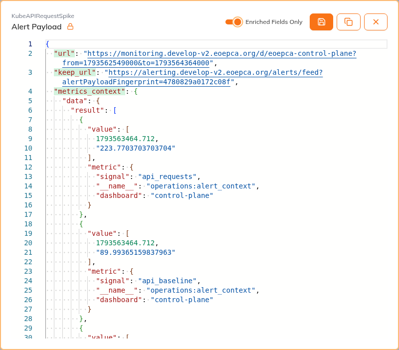
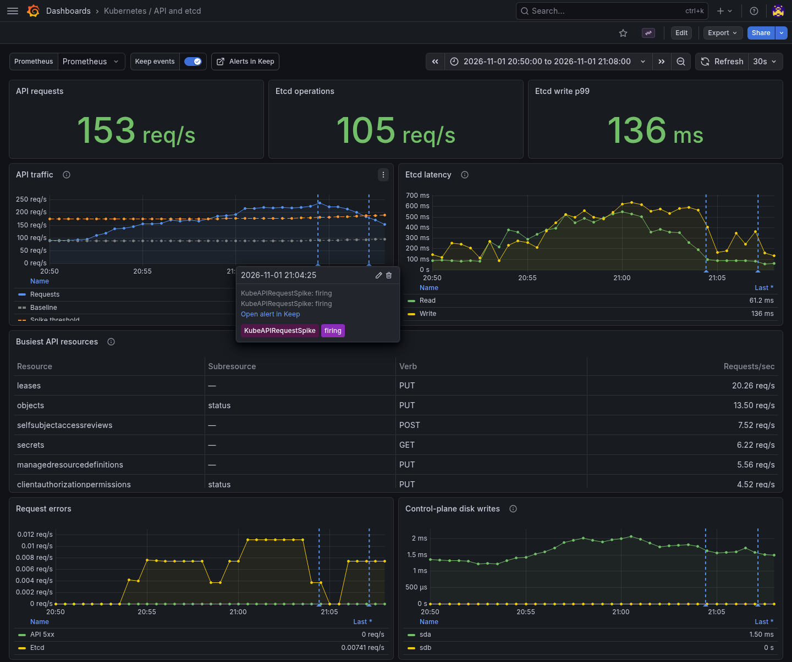
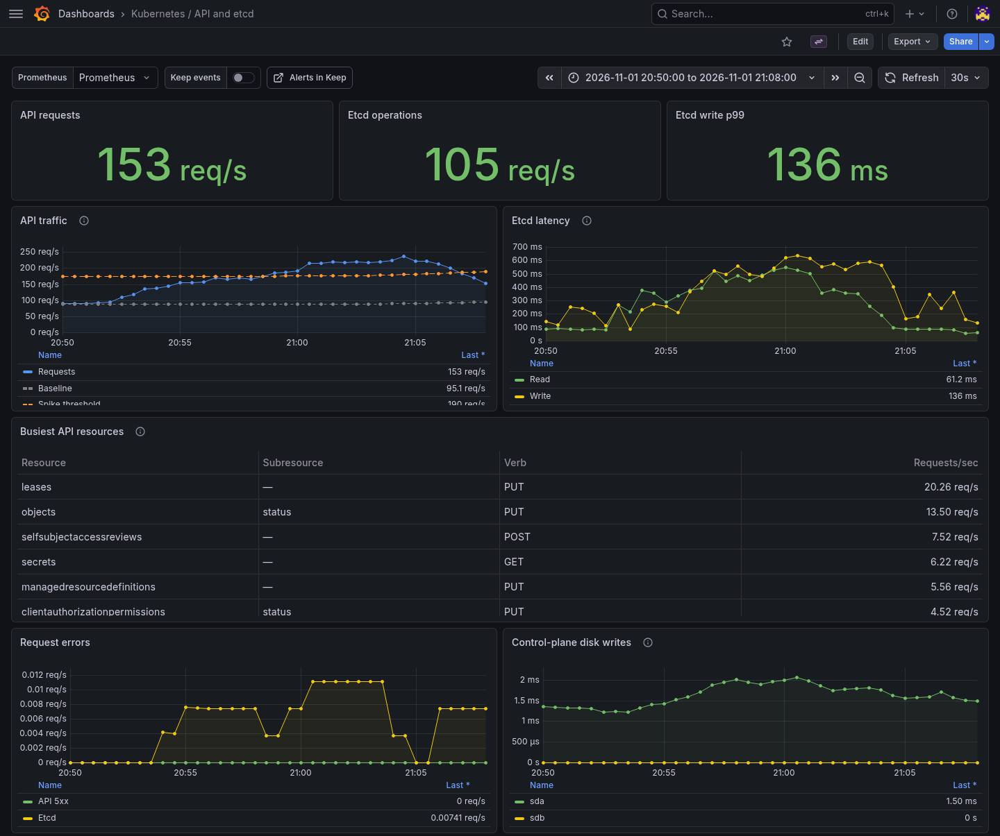

# When Kubernetes API Traffic Rises

Kyverno, Crossplane and other controllers read and update Kubernetes objects
as they work. More controller activity can raise API traffic. The control-plane
charts
show which resources and clients are busy, and whether errors or etcd latency
rise with the traffic.

For this example, we temporarily increased reconciliation in Crossplane's
Kubernetes provider. API traffic rose from about 88 to more than 220 requests
per second. `KubeAPIRequestSpike` fired after traffic stayed above the threshold
for five minutes, and Alertmanager sent it to Keep. API 5xx errors stayed at
zero. The alert rules stayed unchanged.

## Review the Alert in Keep

In the [Keep alert feed](https://alerting.develop-v2.eoepca.org/alerts/feed),
look for `KubeAPIRequestSpike` or an etcd latency alert. When you
take an alert, assign it to yourself and acknowledge it so other operators
can see that someone is handling it.

Keep enriches a new firing alert with a snapshot of API traffic, its earlier
baseline, etcd latency, busy resources, and Crossplane and Kyverno activity.
The alert's Grafana link opens charts for that period, while the saved values
remain in Keep after acknowledgement and resolution.

Open the alert, select **View Alert**, then enable **Enriched Fields Only**
to see the saved links and measurements.

The screenshot shows the saved measurements for `KubeAPIRequestSpike`.

## Compare Events with the Charts

Follow the alert's Grafana link to compare the saved values with the charts
before and after the notification. If you open the
[Kubernetes API and etcd dashboard](https://monitoring.develop-v2.eoepca.org/d/eoepca-control-plane)
directly, set its time range to the incident period.

**Keep events** is on by default. It adds blue markers when Keep handles a
firing or resolved notification. Hover over a marker to see its time, status,
and link back to the alert. These markers come from Keep's event log, which
Alloy sends to Loki for Grafana to read. The saved measurements stay in Keep.

Turning **Keep events** off gives the same charts without the markers, as
shown below. This only changes the display; metrics and alert delivery continue.

| Signal | What to check |
| --- | --- |
| API traffic and earlier baseline | Did traffic rise before errors or latency? |
| Request errors | Are API or backend requests failing? |
| Etcd latency | Is the API waiting for its database? This is backend request latency measured by the API server. |
| Busy API resources | Which resource types and operations account for the requests? |
| Crossplane and Kyverno requests | Which measured clients were busy? |
| Control-plane disk writes | Did node storage latency rise in the same period? |

The resource breakdown shows which API objects were accessed. Client metrics
and logs are needed to identify the callers. A rise in traffic may help explain
a stall, but storage latency can also matter. Compare the timing with care:
markers show when Keep logged the notification, including delivery delay.

## Check Recovery

Returning the provider to its normal settings reduced API traffic. The alert
resolved when the five-minute request average fell below the threshold.

If workspaces or processing jobs were also affected, retry them before closing
the incident. Their completion checks that users can work again. API errors
and latency should also return to normal, and controllers should resume their
work.

The Keep record should explain what changed, whether it helped, and which
measurements were missing. If the problem is limited to STAC requests, the
[STAC scenario](stac-scenario.md) follows that request path in more detail.

The [dashboard guide](dashboards-and-usage.md#keep-events) covers missing
markers. The [alerting reference](alerting-and-slos.md#keep-for-alert-enrichment)
explains the shared workflows and snapshot limits. The
[deployment sources](https://github.com/EOEPCA/eoepca-plus/tree/deploy-develop/argocd/eoepca/operations/parts)
contain the rules and dashboard.
