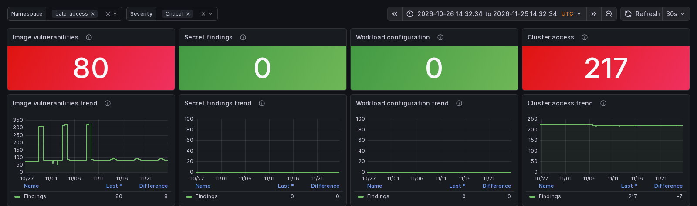
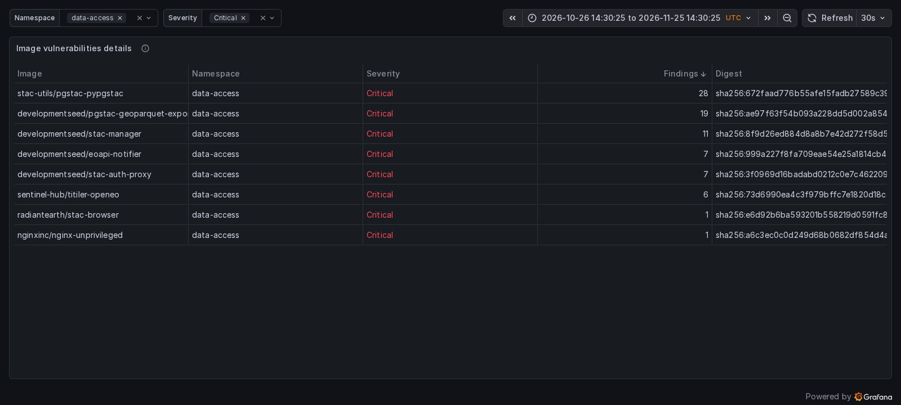

# Dashboards and Usage

Grafana dashboards show service behaviour and the components behind it. The
dashboard for the reported problem is usually the best starting point, with
the time range set to include the first symptom and any recent change.

## How Dashboards Are Provisioned

The dashboards are generated as ConfigMaps under [`argocd/eoepca/operations/parts/_dashboards`](https://github.com/EOEPCA/eoepca-plus/tree/deploy-develop/argocd/eoepca/operations/parts/_dashboards) and labeled with `grafana_dashboard: "1"`.

Grafana loads them automatically, so no manual import is needed. Each dashboard
has the `baseline` tag. Public links are set in the manifests, and stable
dashboard IDs preserve bookmarks and alert links. The
[configuration reference](alerting-and-slos.md#shared-configuration) explains
how Keep uses those links.

The live `operations` namespace contains dashboard ConfigMaps for:

- `curated-prometheus-overview`
- `curated-k8s-resources-cluster`
- `curated-k8s-resources-node`
- `curated-k8s-resources-pod`
- `curated-control-plane`
- `curated-crossplane`
- `curated-volumes`
- `curated-security-compliance`
- `curated-stac-slo`
- `workspaces-overview`

The Compliance dashboard shows Trivy scan findings. Kyverno policy results
remain available in the source policy reports.

## Current Dashboards

<span id="prometheus-overview"></span>

### Prometheus

Source: [`prometheus.json`](https://github.com/EOEPCA/eoepca-plus/blob/deploy-develop/argocd/eoepca/operations/parts/_dashboards/prometheus.json)

When monitoring data is missing or looks wrong, this dashboard helps check
Prometheus itself. It shows target discovery and sync, scrape failures,
appended samples, query rate, and storage state.

### Kubernetes Cluster

Source: [`kubernetes-cluster.json`](https://github.com/EOEPCA/eoepca-plus/blob/deploy-develop/argocd/eoepca/operations/parts/_dashboards/kubernetes-cluster.json)

This dashboard compares namespaces by CPU and memory use, requested and
limited capacity, and network and storage activity. It helps locate an affected
namespace when the report does not yet identify a workload.

### Kubernetes Pods

Source: [`kubernetes-pods.json`](https://github.com/EOEPCA/eoepca-plus/blob/deploy-develop/argocd/eoepca/operations/parts/_dashboards/kubernetes-pods.json)

Once the namespace is known, the Pod dashboard shows container CPU use and
throttling, memory working set against requests and limits, and network and
disk activity. These measurements help narrow the investigation to a workload
or container.

### Kubernetes Nodes

Source: [`kubernetes-nodes.json`](https://github.com/EOEPCA/eoepca-plus/blob/deploy-develop/argocd/eoepca/operations/parts/_dashboards/kubernetes-nodes.json)

Node capacity and scheduling pressure can explain why workloads do not start
or run slowly. This dashboard is also useful when several affected workloads
share a node.

### Kubernetes API and etcd

Source: [`kubernetes-api-and-etcd.json`](https://github.com/EOEPCA/eoepca-plus/blob/deploy-develop/argocd/eoepca/operations/parts/_dashboards/kubernetes-api-and-etcd.json)

The [demo dashboard](https://monitoring.develop-v2.eoepca.org/d/eoepca-control-plane)
shows API traffic against its earlier baseline, API errors, availability, and
etcd latency. Resource views show what the API handles. Crossplane and Kyverno
client activity helps identify measured sources of requests.

When several services report errors or resource creation becomes slow, these
charts can show a shared API or etcd problem. Controller activity needs to be
compared over the same time range before attributing load to a controller. The
[control-plane scenario](control-plane-scenario.md) explains the investigation
and the links between Keep alerts and Grafana chart markers.

### Crossplane Reconciliation

Source: [`crossplane-reconciliation.json`](https://github.com/EOEPCA/eoepca-plus/blob/deploy-develop/argocd/eoepca/operations/parts/_dashboards/crossplane-reconciliation.json)

The [demo dashboard](https://monitoring.develop-v2.eoepca.org/d/eoepca-crossplane)
shows reconciliation rates and p99 duration for Datalab and Storage composition
controllers and provider managed-resource controllers. Error panels show the
total for the selected period and errors per minute. The **Provider** selector
filters provider charts. CRD gate controllers are excluded.

Rates and p99 duration use five-minute windows. Composition counts include
periodic checks and runs triggered by watched changes. They combine all
resources of each type; they do not identify an individual workspace or the
trigger for a run. Successful scheduled requeues are not errors.

### Kubernetes Volumes

Source: [`volumes.json`](https://github.com/EOEPCA/eoepca-plus/blob/deploy-develop/argocd/eoepca/operations/parts/_dashboards/volumes.json)

The [demo dashboard](https://monitoring.develop-v2.eoepca.org/d/eoepca-volumes)
shows local and block volume capacity, free space, inodes, and estimated time
to full. It also identifies mounted claims without capacity metrics, where
usage alerts cannot run. Network and virtual filesystems are excluded from
these volume panels.

Separate sections show node filesystems and shared NFS capacity across all
namespaces. The volume namespace and storage class filters do not limit these
sections. NFS values describe the shared filesystem; PVC requests are not
directory quotas. Adding the capacity of its claims would count the same
space more than once.

Snapshot panels have separate namespace, driver, and class filters. They show
ready snapshots, pending request age, creation and deletion problems, and
collection health. Check **Snapshot monitoring** before treating an empty list
as no snapshots. Snapshot readiness does not measure physical storage use or
prove that a restore has been tested.

The [storage alert rules](alerting-and-slos.md#storage-alerts) define the limits
and delays used to detect these conditions.

### STAC

Source: [`stac.json`](https://github.com/EOEPCA/eoepca-plus/blob/deploy-develop/argocd/eoepca/operations/parts/_dashboards/stac.json)

The **STAC** dashboard follows the request path from APISIX ingress to
`stac-auth-proxy` and `eoapi-stac`. The ingress section shows public request and
server-error rates, request/upstream/gateway p99, and GET/POST latency budget
burn. Separate proxy and backend sections use each service's own counters and
histograms to show:

- the share of GET and POST requests within 500 ms over 30 days
- latency error budget use and one-hour and six-hour burn rates
- request rate, HTTP 5xx errors, and p99 latency
- mean query latency for the shared eoapi database in the backend section

The target is 99% of requests within 500 ms. A burn rate above one uses the
budget faster than allowed; more than 100% budget used exceeds the target.
Periods without traffic show no data. Proxy and backend counts include some
of the same requests, so adding them would count requests more than once.
The alert rules measure the public APISIX route.

<span id="security-compliance"></span>

### Compliance

Source: [`compliance.json`](https://github.com/EOEPCA/eoepca-plus/blob/deploy-develop/argocd/eoepca/operations/parts/_dashboards/compliance.json)

The [demo dashboard](https://monitoring.develop-v2.eoepca.org/d/eoepca-security-compliance-namespace)
has four columns for Trivy image vulnerabilities, secret findings, workload
configuration, and access findings. Each has a count, trend, and detail table.
Namespace and severity selectors filter all three views. Open the matching
Trivy report to confirm the affected image or resource before a change.

[](img/compliance/overview.png)

The namespace filter is `data-access`, with **Critical** severity and 30 days
of history. ClusterRole findings still apply to all namespaces.

Image findings count once per digest and namespace. Vulnerability totals count
finding rows, not distinct CVE IDs. Secret findings come from image scans, not
scans of live Kubernetes Secrets. A falling trend can result from fixes, new
scan results, workload changes, or missing reports; it does not prove recovery.

Use the panel menu's **View** option to read a detail table at full width.
The example below shows **Critical** findings in `data-access`.

[](img/compliance/image-vulnerabilities.png)

The **Scan health** section shows vulnerability reports older than
26 hours and failed or missing Trivy and kube-state-metrics scrape targets.
Collection failures leave gaps in the trends. Zero findings do not prove that
all expected workloads have fresh scans.

### Workspaces

Source: [`workspaces.json`](https://github.com/EOEPCA/eoepca-plus/blob/deploy-develop/argocd/eoepca/operations/parts/_dashboards/workspaces.json)

The workspace selector compares running sessions, CPU and memory use, requested
PVC storage, and owned buckets for one or more workspaces. Each workspace
includes its main, session, and control-plane namespaces. The dashboard opens
with 24 hours of history.

Managed data panels show HTTP requests, successful and failed presigned URL
requests, transfer bytes, and collection health. Activity totals cover the
selected period. Requested PVC storage is allocated capacity; transfer bytes
measure data movement. Neither measures stored data.

The [workspace scenario](workspace-scenario.md) explains the session counts,
recording rules, PodMonitor, and a short investigation example.

## Keep Events

**Kubernetes API and etcd**, **STAC**, and **Kubernetes Volumes** have a
**Keep events** control, enabled by default. With the incident period selected,
it places alert notifications on the charts alongside the measurements.

On time-series charts such as API traffic and etcd latency, blue lines and
small markers show these events. Hover over a marker for the alert name,
`firing` or `resolved` status, time, and **Open alert in Keep** link. Both states
use blue, so the status text distinguishes them. Stat cards and tables have
no markers. If the link opens only Keep's feed, the matching alert can be
selected there.

For example, `EtcdRequestLatencyHigh: firing` marks a notification handled by
Keep. A later `EtcdRequestLatencyHigh: resolved` marks its recovery notification.
The measurements around these points show what was happening when Keep handled
each notification. Each marker is a separate event; the chart does not shade
the whole incident period.

Turning off **Keep events** hides the markers. Alerts still reach Keep, and
the metric charts continue to work. Assignment, acknowledgement, and response
notes stay in Keep. The saved metrics snapshot also stays with the alert.

Grafana reads up to 100 matching log entries for the selected period. If there
are more events, a shorter range is needed to see them. Marker times come from
the workflow log and include alert delivery and processing delay.

If markers are missing, check the same period in Grafana Explore with the
Loki data source:

```logql
{namespace="operations",container="keep"}
  | json | event_type="keep_alert_event"
```

No matching events can mean that no covered alert changed state, or that the
workflow or log collection failed. Check the workflow execution in Keep and
the Alloy/Loki collection path. Marker history follows Loki log retention.
If Keep history is cleared, older markers can remain after their linked alerts
have been removed.
The `dashboard_uid` field identifies the target dashboard; each dashboard's
query selects it with `${__dashboard.uid}`. The
Kubernetes API and etcd dashboard also reads the earlier event format to
retain history.
The [alerting reference](alerting-and-slos.md#keep-events-in-grafana) describes
the workflows that produce these events. Grafana calls the marker query a
[Loki annotation query](https://grafana.com/docs/grafana/latest/datasources/loki/annotations/).

## Typical Operator Usage

An alert's dashboard link provides a starting point. For a user report without
an alert, the affected service determines where to start: STAC for searches,
Workspaces for sessions and managed data, Kubernetes Volumes for storage and
snapshots, or Compliance for Trivy findings. Missing or inconsistent
measurements need a Prometheus check first.

For a broader resource problem, Kubernetes Cluster helps locate the
namespace, then Kubernetes Pods gives container detail. Kubernetes Nodes
helps when the affected workloads share a node or show scheduling pressure.
If workspace creation and several controllers fail together, API/etcd charts
may reveal a shared dependency problem. Crossplane Reconciliation helps check
controller rates, duration, and errors when managed resources are slow to become
ready.

Loki logs and source scan or policy reports provide details behind the charts.
The [STAC](stac-scenario.md) and [control-plane](control-plane-scenario.md)
scenarios show this investigation with Keep and Grafana screenshots.

## Dashboard Checks

- Set the time range to include the first symptom and the most recent relevant
  change.
- Match the service, namespace, workload, and route filters across the panels
  being compared. These dashboards cover the single `eoepca-demo` cluster.
- Treat an empty panel as unknown until you confirm the target, query, and data
  source.
- Open the source metric, log, policy report, or scan report before you approve
  a change.
- Reuse the same dashboard and filters during Verify so that before-and-after
  evidence is comparable.
