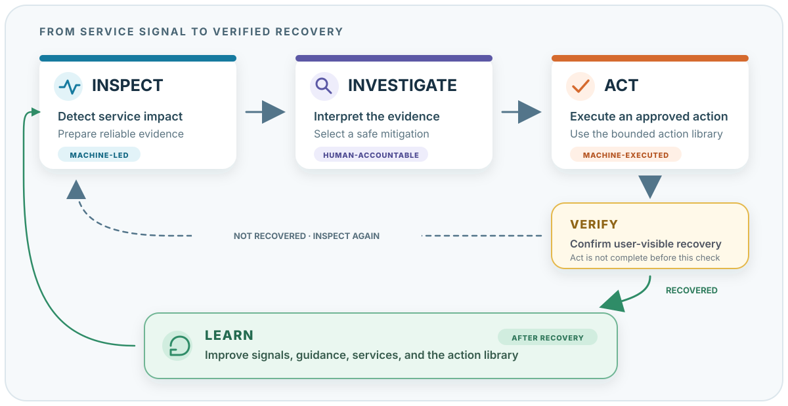

# Operating Model

EOEPCA services use gateways, workloads, databases, and background components.
The operating model describes how an operator checks a reported problem,
chooses a response, and verifies recovery. Operators use monitoring data and
their knowledge of the service at each step.

{ .operations-model }

The model separates finding a problem, understanding it, changing the system,
and improving the next response. It describes the work an operator needs to do
and where the tools can help.

Verify is part of Act: an operation is not complete until the service outcome
has been checked. Learn follows recovery and feeds the experience back into the
next response.

## Operating Rules

- Start by checking what the user cannot do or what has become slow.
- Check the monitoring path when evidence is missing or inconsistent.
- Treat recent changes, logs, and scan findings as evidence. Confirm them with
  another source before you identify a cause.
- Confirm the action target and preconditions before a change.
- Verify the external service result after a change. A successful command or a
  healthy Pod is not sufficient.

## Observe: Inspect

Automated checks perform most of **Inspect** and collect the results for the
operator.

Monitoring checks whether a service behaves as users expect. It detects
failures and slow responses, groups related signals, and prepares the facts an
operator needs.

For an HTTP service, Inspect may combine:

- a synthetic request that fails or becomes slow
- an SLO or error-budget burn-rate alert
- request latency and error metrics
- gateway and upstream timings
- pod health and saturation
- dependency signals
- logs and recent deployment changes

The results should show the affected service and operation, what users
experience, when the problem started, how broad the impact is, and the
supporting evidence.

Inspect reports observations. A deployment shortly before an incident is
relevant evidence, but it is not automatically the root cause.

## Decide: Investigate

The operator is responsible for **Investigate**, with tools to collect and
compare the evidence.

The platform should collect and organise evidence safely and consistently. The
operator interprets it, tests likely explanations, decides what is known and
uncertain, and selects a mitigation.

For a slow STAC request path, the operator may ask:

- is APISIX adding latency, or reporting a slow upstream?
- is the STAC application saturated or restarting?
- is PostgreSQL slow or connection-limited?
- did a recent change plausibly affect the service?
- which action is safe enough to reduce the current user impact?

During an active incident, the operator does not always need the full root
cause. They need enough evidence to choose a safe mitigation. Deeper analysis
belongs in Learn after the service has recovered.

Prepare dashboards, log queries with time and resource limits, dependency
checks, timelines, and links to relevant procedures in advance. The operator
can then use them during an incident.

## Change: Act and Verify

During **Act**, the system runs the approved action within its permitted scope.

Once a mitigation is selected and approved, the system runs a known action the
same way each time. The operator chooses from a library of remediation actions
instead of assembling commands during an incident.

**Verify** completes Act.

A finished command or workflow does not mean the action worked. The service
must be checked again. A workload restart, for example, is complete only when
the workload is healthy, the external request succeeds, the relevant SLO
signals recover, and the result remains stable for a suitable period.

If verification fails, the system returns to investigation. It may stop, roll
back, retry within a defined limit, or escalate, depending on the action.

## Improve: Learn

**Learn** happens after recovery.

The team reviews the incident timeline, deeper causes, missing or misleading
signals, the selected action, and the verification result. This should improve
how the service is run:

- better metrics, SLOs, or synthetic checks
- clearer investigation guidance
- safer or more useful remediation actions
- stronger preconditions and verification
- follow-up changes that prevent recurrence

Restore service first. Use the later review to improve the checks and
procedures for the next incident.

## Service Examples

The [STAC service-path example](stac-scenario.md) follows an HTTP request
through detection, investigation, action, verification, and review. The
[workspace example](workspace-scenario.md) uses session, resource, and managed
data metrics to investigate workspace problems.

## From Investigate to Act

A library of named remediation actions connects Investigate to Act. Operators
select a known outcome instead of assembling commands during an incident.

The action library is still in development. The
[Remediation Actions](remediation-actions.md) page explains the purpose,
action requirements, and execution flow.

## How the Current Stack Supports the Model

| Stage | Current role |
| --- | --- |
| Inspect | Prometheus, SLO rules, synthetic checks, Alertmanager, and health signals detect and correlate degradation. |
| Investigate | Keep presents alerts and context; Grafana, Loki, Kubernetes, and service-specific signals help the operator find the affected component. |
| Act | A small [remediation-action library](remediation-actions.md) is in development. Existing scripts and procedures can run the actions. |
| Verify | Synthetics, workload health, and the same service signals used by Inspect confirm whether recovery occurred. |
| Learn | The incident record and observed outcomes improve monitoring, guidance, actions, and service design. |

The remaining pages explain the monitoring stack, signals, dashboards, and SLOs
that support the model.
