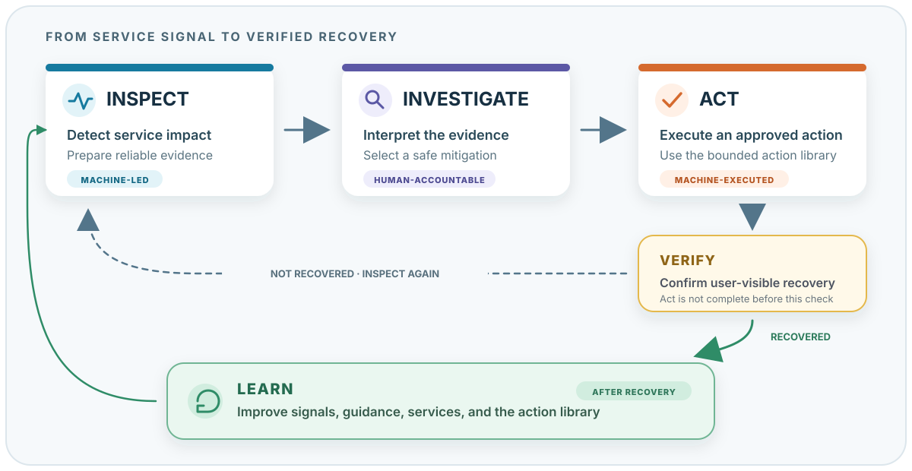

# Operating Model

A reported failure can pass through several components before it reaches the
user. This model describes how an operator follows that problem, chooses a
change, and checks whether it helped. Monitoring provides measurements and
logs; service knowledge helps the operator interpret them.

{ .operations-model }

## Operating Rules

The first question is what the user cannot do, or what has become slow.
Missing or inconsistent data needs a check of the monitoring path before it
can support a decision. Recent changes, errors, and scan findings can suggest
a cause, but need confirmation from other evidence.

Before a change, the operator confirms its target and preconditions. After
the change, the user-facing operation must work again. A successful command
or a healthy Pod is only part of that check.

## Observe: Inspect

Automated checks perform most of **Inspect**. They detect failed or slow
requests and collect the measurements that an operator needs to start an
investigation.

For an HTTP service, Inspect may combine:

- a synthetic request that fails or becomes slow
- an SLO or error-budget burn-rate alert
- request latency and error metrics
- gateway and upstream timings
- pod health and saturation
- dependency signals
- logs and recent deployment changes

Together, the results should show which operation is affected, when the
problem started, and how many users or services it affects. A deployment
shortly before the first error is worth checking, but timing alone does not
establish the cause.

## Decide: Investigate

During **Investigate**, the operator compares measurements and logs to test
possible causes. The tools supply evidence, but the operator decides whether
it is enough to choose a response.

For a slow STAC request path, the operator may ask:

- is APISIX adding latency, or reporting a slow upstream?
- is the STAC application saturated or restarting?
- is PostgreSQL slow or connection-limited?
- did a recent change plausibly affect the service?
- which action is safe enough to reduce the current user impact?

The investigation can continue after service has been restored. Once there is
enough evidence for a safe action, the operator can proceed and leave deeper
questions for the later review.

Saved dashboards, log queries, dependency checks, and procedures reduce the
work needed during an incident. Queries need time and resource limits so
that the investigation does not add unnecessary load.

## Change: Act and Verify

During **Act**, the approved procedure runs on the selected targets and within
its limits. The planned remediation-action library will hold these procedures.

**Verify** is part of Act. After a workload restart, for example, the operator
checks that the workload is healthy and repeats the external request. The
relevant SLO signals must also recover and remain stable for a suitable
period before the action is complete.

If verification fails, the system returns to investigation. It may stop, roll
back, retry within a defined limit, or escalate, depending on the action.

## Improve: Learn

After recovery, **Learn** gives the team time to review the cause, timeline,
action, and recovery checks. Missing or misleading measurements also belong
in this review. The findings can lead to:

- better metrics, SLOs, or synthetic checks
- clearer investigation guidance
- safer or more useful remediation actions
- stronger preconditions and verification
- follow-up changes that prevent recurrence

## Service Examples

The [STAC example](stac-scenario.md) starts with a slow HTTP request, and the
[workspace example](workspace-scenario.md) starts with a slow session or failed
data request. The [control-plane example](control-plane-scenario.md) follows
increased controller activity and its effect on the Kubernetes API. All three
use the same investigation and recovery process.

## From Investigate to Act

The [remediation-action library](remediation-actions.md) is still in
development. Each action will state when it can help, what it changes,
who approves it, and how to check recovery.

## How the Current Stack Supports the Model

| Stage | Current role |
| --- | --- |
| Inspect | Prometheus, SLO rules, synthetic checks, and health signals detect degradation. Alertmanager groups and routes the alerts. |
| Investigate | Keep presents alerts and context; Grafana, Loki, Kubernetes, and service-specific signals help the operator find the affected component. |
| Act | A small [remediation-action library](remediation-actions.md) is in development. Existing scripts and procedures can run the actions. |
| Verify | Synthetics, workload health, and the same service signals used by Inspect confirm whether recovery occurred. |
| Learn | The incident record and observed outcomes improve monitoring, guidance, actions, and service design. |
