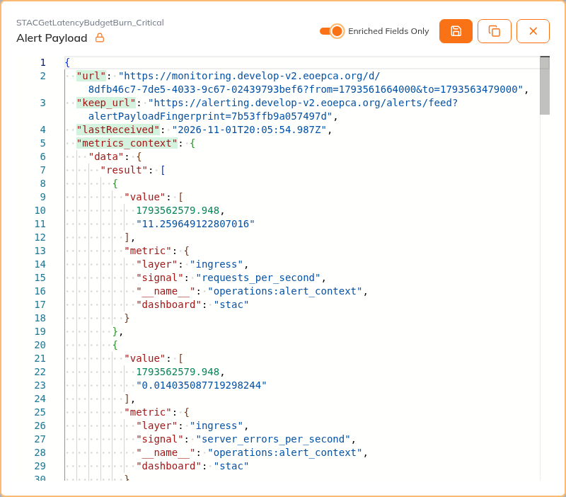
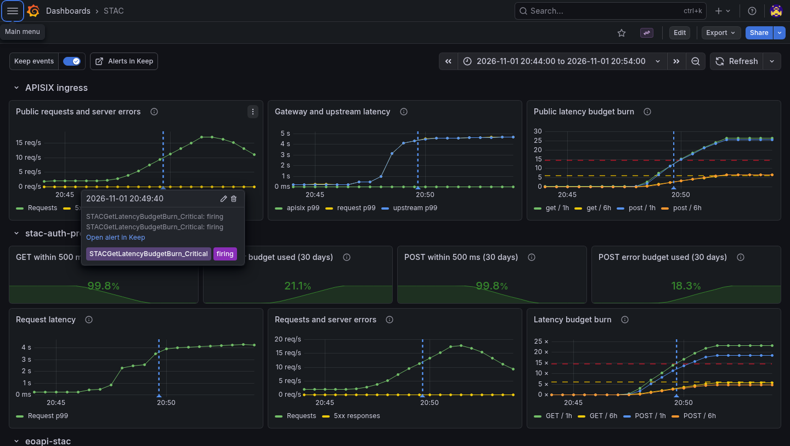
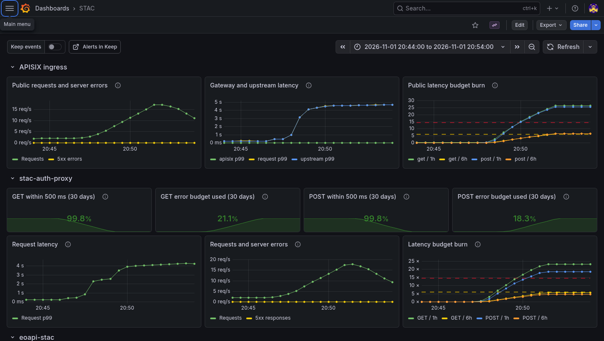

# When a STAC Request Slows Down

A user reports slow or failed STAC searches. The request passes through
APISIX, the authorisation proxy, the STAC API, and PostgreSQL/pgSTAC. Comparing
these layers helps locate the delay or failure.

The demo's public endpoint is <https://eoapi.develop-v2.eoepca.org/stac>.
The target is 99% of GET and POST requests within 500 ms. A burn-rate alert
fires when the share of slow requests is too high.

For this example, we increased the synthetic STAC checker from two to 40
replicas. More requests reached the public endpoint, latency rose, and the
GET and POST critical alerts fired. Alertmanager sent them to Keep through
the normal alert route. The alert rules stayed unchanged.

## Review the Alert in Keep

In the [Keep alert feed](https://alerting.develop-v2.eoepca.org/alerts/feed),
look for a STAC GET or POST latency alert around the time of the user's report.
Its operation helps narrow the investigation to the affected requests. When
you take an alert, assign it to yourself and acknowledge it so other operators
can see that someone is handling it.

Keep enriches a new firing alert with a snapshot from the gateway, proxy, API,
and database. The alert's Grafana link opens charts for that period, while
the saved values remain in Keep after acknowledgement and resolution.

Open the alert, select **View Alert**, then enable **Enriched Fields Only**
to see the saved links and measurements.

The screenshot shows the GET alert with its saved measurements. Keep also
received the POST alert from the same load test.

## Compare Events with the Charts

Follow the alert's Grafana link to compare the saved values with the charts
before and after the notification. If you open the
[STAC dashboard](https://monitoring.develop-v2.eoepca.org/d/8dfb46c7-7de5-4033-9c67-02439793bef6)
directly, set its time range to the incident period.

**Keep events** is on by default. It adds blue markers when Keep handles a
firing or resolved notification. Hover over a marker to see its time, status,
and link back to the alert. These markers come from Keep's event log, which
Alloy sends to Loki for Grafana to read. The saved measurements stay in Keep.

Turning **Keep events** off gives the same charts without the markers, as
shown below. This only changes the display; metrics and alert delivery continue.

| Signal | What to check |
| --- | --- |
| APISIX ingress | Are public requests slow or failing? Compare request, upstream, and gateway latency with GET/POST budget burn. |
| Auth proxy | Did errors or latency rise for the affected STAC operation? |
| STAC API | Does the backend show the same delay, errors, or workload pressure? |
| Database | Did mean query latency rise in the shared eoapi database? |

The ingress panels are the starting point because the alert rules measure
this public route. Comparing them with the proxy and API panels shows whether
the delay is also visible further along the request path. Logs from that
period can give request details. If both services slow down, the database or
another shared dependency may need investigation.

The same request can appear at several layers, so adding their counts would
count it more than once. Their p99 values may describe different requests;
subtracting them does not give the delay between layers. The database mean
also covers the shared database, rather than STAC alone. An empty panel needs
a collection check before it can support a conclusion. Marker times include
notification delay.

## Check Recovery

We returned the checker to two replicas after the alerts fired. Traffic and
latency fell, but the alerts stayed firing because their one-hour window
still included the slow requests.

After an approved change, repeat the user's search through the public endpoint.
Successful requests, including the synthetic checks, and lower errors and
latency show whether the change helped. These need to remain stable before
the incident is closed. The burn rate can take longer to fall because its
window still includes older slow requests; a ready Pod or resolved alert alone
does not confirm recovery.

The Keep record should explain what changed, whether it helped, and which
measurements were missing. If several services are affected together, the
[control-plane scenario](control-plane-scenario.md) helps investigate the
Kubernetes API as a shared dependency.

The [dashboard guide](dashboards-and-usage.md#stac) and
[alerting reference](alerting-and-slos.md#keep-for-alert-enrichment) describe the
measurements and shared workflows. The
[STAC rules](https://github.com/EOEPCA/eoepca-plus/blob/deploy-develop/argocd/eoepca/operations/parts/_rules/stac-alerts.yaml)
and [synthetic checker](https://github.com/EOEPCA/eoepca-plus/blob/deploy-develop/argocd/eoepca/data-access/parts/synthetic-api-check/check-stac.sh)
define the service checks. The [remediation-action library](remediation-actions.md)
is still in development.
